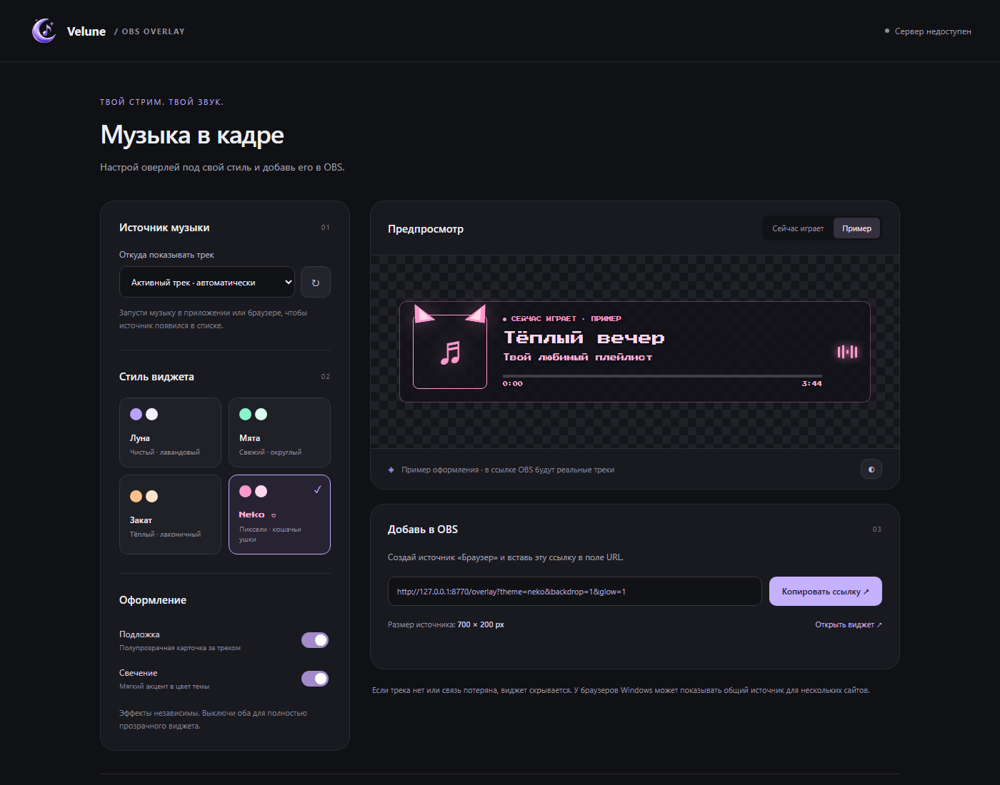
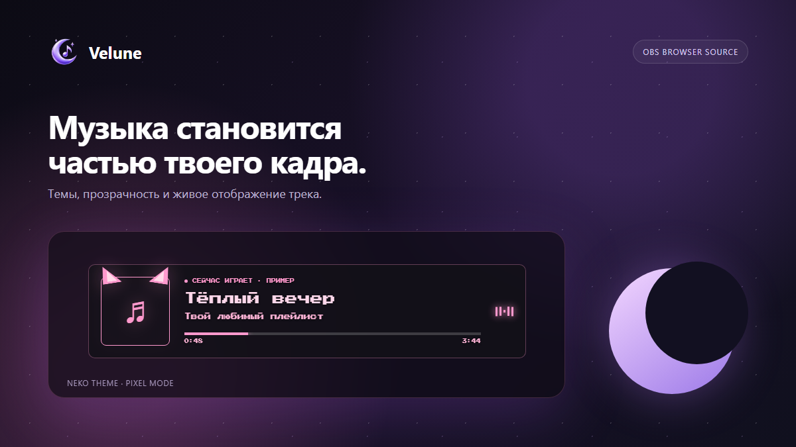

# Текст для форума

## Velune — ищу первых тестировщиков 🎵

Привет! Я сделал **Velune** — небольшую программу для отображения текущего трека на стриме через OBS.

Можно выбрать источник музыки, настроить оформление, включить подложку или свечение и просто скопировать готовую ссылку в источник «Браузер» в OBS. Есть несколько тем — от спокойной лавандовой до розовой пиксельной **Neko** с кошачьими ушками 🐱

Сейчас проекту очень нужны первые тестировщики. Буду рад, если попробуете Velune на своём компьютере и расскажете:

- увидела ли программа ваш музыкальный источник;
- нормально ли работает виджет в OBS;
- не ломается ли сворачивание в трей;
- какая тема понравилась больше;
- чего вам не хватает для стрима.

Особенно интересны тесты с Яндекс Музыкой, браузерами и разными разрешениями OBS. Если что-то не заработает — пишите, даже короткое описание ошибки сильно поможет довести программу до ума 💜

**Windows 10/11 · бесплатно для некоммерческого использования**

👉 **Скачать:** [вставить ссылку на GitHub Release]

